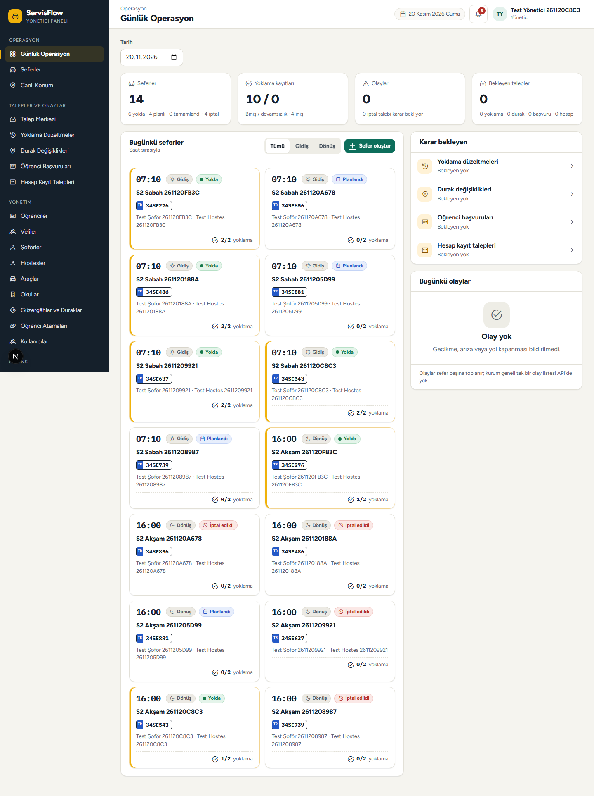
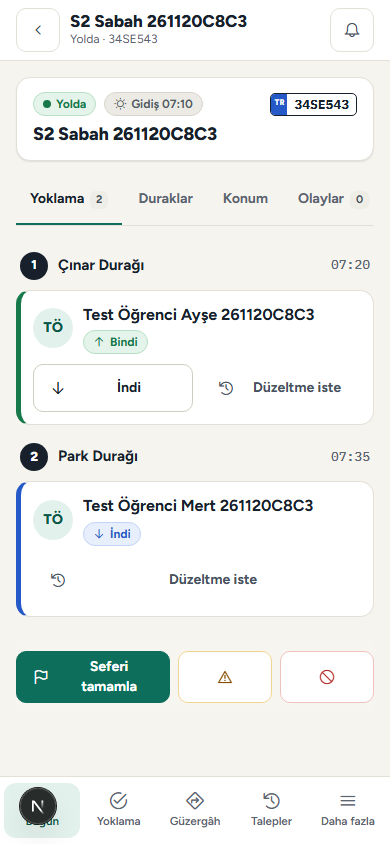
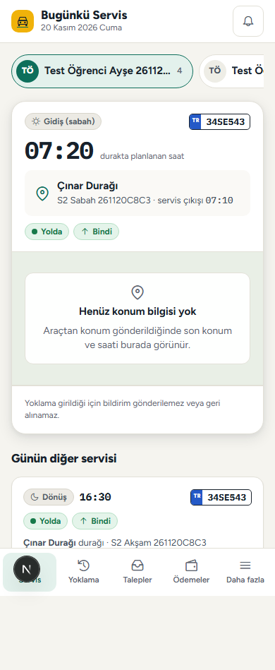
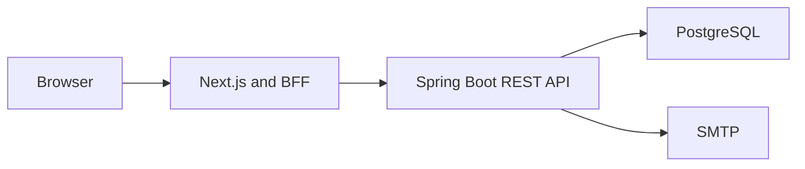

# ServisFlow

**School transportation management for a single institution.**

ServisFlow brings trip planning, student attendance, parent communication, and transport billing into one application. Drivers and attendants use mobile-friendly trip screens, while parents and students see the information relevant to their own accounts. The application interface is in Turkish.

## What it does

| Role | Main workflows |
| --- | --- |
| Administrator | Manage students, vehicles, routes, stops, and trip assignments. Review attendance corrections and cancellation requests. Run billing and record payments. |
| Driver | View assigned trips, record attendance, report incidents, and request cancellations. |
| Attendant | View assigned trips and passenger lists, record boarding and drop-off, and submit attendance corrections. |
| Parent | View linked children’s trips and attendance, report a planned absence, and review balances and statements. |
| Student | View their own trip, route, and attendance after an administrator links the account. |

## Backend engineering highlights

- **Attendance and audit history.** A parent’s planned absence is separate from the official attendance record. Staff can request corrections, administrators review them, and stale corrections return a conflict.
- **Transactional billing.** Monthly charge generation is idempotent. Partial payments update the remaining balance, and overpayments are rejected. The acceptance suite checks that a ₺450 payment against a ₺1,200 charge leaves ₺750 due.
- **Role and record-level authorization.** Spring Security enforces roles, and backend policies scope access to assigned trips, linked children, or the student’s own record. Only administrators can manage the one-to-one student account link. Database uniqueness and transaction locking enforce that relationship.
- **Session lifecycle.** The Next.js backend for frontend (BFF) uses HttpOnly cookies and coordinates session renewal. Acceptance tests cover expired access tokens, sign-out, email verification, and password reset.

## Screenshots

All screenshots use synthetic test data generated by the acceptance suite.

| Administrator: daily operations | Driver: mobile attendance | Parent: today's service |
| --- | --- | --- |
|  |  |  |

## Architecture



| Layer | Technologies and responsibilities |
| --- | --- |
| Backend | Java, Spring Boot, Spring Security, Spring Data JPA, Maven. Business rules, authorization, and transactions. |
| Data | PostgreSQL and Flyway. Versioned schema changes and database constraints. |
| Frontend | React, Next.js App Router, PrimeReact, SCSS, TanStack Query. Role-specific screens and server-state management. |
| Test infrastructure | Testcontainers, Vitest, Playwright, Docker Compose, Mailpit. Repeatable tests against a real backend and an isolated PostgreSQL database. |

Backend code is grouped by business domain, with controller, service, and persistence layers. Frontend code uses feature modules with UI components, API services, actions, and styles.

## Documentation

The design documents are in Turkish.

| Document | Contents |
| --- | --- |
| [API contract](docs/API.md) | REST endpoints, request and response shapes, error codes |
| [RBAC matrix](docs/RBAC_MATRIX.md) | Role permissions and record-level scope rules |
| [Database design](docs/DATABASE_DESIGN.md) | Tables, constraints, and Flyway migrations |
| [Security](docs/SECURITY.md) | BFF, cookie, CSRF, and token responsibilities |
| [Requirements](docs/REQUIREMENTS.md) and [known limitations](docs/KNOWN_LIMITATIONS.md) | Scope and open items |
| [Design system](docs/design/DESIGN_SYSTEM.md) and [frontend guide](docs/design/SPRINT2_FRONTEND_GUIDE.md) | UI tokens, components, and frontend conventions |

## Reported local verification

| Check | Result |
| --- | --- |
| Backend tests | 300 passed |
| Frontend unit tests | 88 passed |
| Browser acceptance tests | 15 passed in each of two clean runs |
| Frontend lint and production build | Passed |

The acceptance runs used Spring Boot, an isolated PostgreSQL database, and Mailpit. The frontend production build passed separately. The browser acceptance suite ran against the Next.js development server.

## Local development

Prerequisites are JDK 17, Node.js 20.19+, Docker Desktop, and PowerShell.

From the repository root, create the local configuration files for PostgreSQL, Mailpit, and the application. Replace the placeholder secrets in `.env` (`JWT_SECRET`, `BFF_COOKIE_SECRET`, `BOOTSTRAP_ADMIN_PASSWORD`) and copy the same `BFF_COOKIE_SECRET` into `frontend/.env.local`. Neither file is committed.

```powershell
Copy-Item .env.example .env
Copy-Item frontend\.env.example frontend\.env.local
```

After editing the files, start PostgreSQL and Mailpit:

```powershell
docker compose --env-file .env up -d
```

Start the backend. Maven downloads dependencies on the first run:

```powershell
powershell -ExecutionPolicy Bypass -File scripts\start-backend.ps1
```

In a second PowerShell window, start the frontend:

```powershell
cd frontend
npm ci
npm run dev
```

Open `http://localhost:3000`. For two isolated acceptance runs, execute this command from the repository root:

```powershell
powershell -ExecutionPolicy Bypass -File scripts\e2e.ps1 -Runs 2
```

### Run a second local checkout

If another ServisFlow instance is already running, use a separate Compose project and PostgreSQL volume. In the second checkout's root `.env`, set the following values after checking that the ports are free:

```dotenv
DEV_RESOURCE_SUFFIX=-clean
POSTGRES_PORT=55435
DB_URL=jdbc:postgresql://localhost:55435/school_service
MAILPIT_SMTP_PORT=11026
MAILPIT_UI_PORT=18026
MAIL_PORT=11026
SERVER_PORT=18081
RESET_PASSWORD_BASE_URL=http://localhost:3101/sifre-sifirla
REGISTRATION_VERIFICATION_BASE_URL=http://localhost:3101/e-posta-dogrula
OAUTH_REDIRECT_BASE_URL=http://localhost:3101
```

Set `BACKEND_INTERNAL_URL=http://localhost:18081` and `OAUTH_REDIRECT_BASE_URL=http://localhost:3101` in the second checkout's `frontend/.env.local`. Start Compose with the separate project name, run the backend script from the same root, and start Next.js on port 3101:

```powershell
docker compose -p ssp-clean --env-file .env up -d --wait
powershell -ExecutionPolicy Bypass -File scripts\start-backend.ps1
# In a second window, from the second checkout:
cd frontend
npm ci
npm run dev -- --port 3101
```

Open `http://localhost:3101`. To stop PostgreSQL and Mailpit for this checkout while retaining its volume, run `docker compose -p ssp-clean --env-file .env down` from its root.

## Release status

The application has completed local acceptance testing. Production-like staging, the database migration rehearsal, and the restore rehearsal are the next release milestones.
